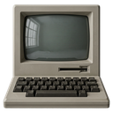
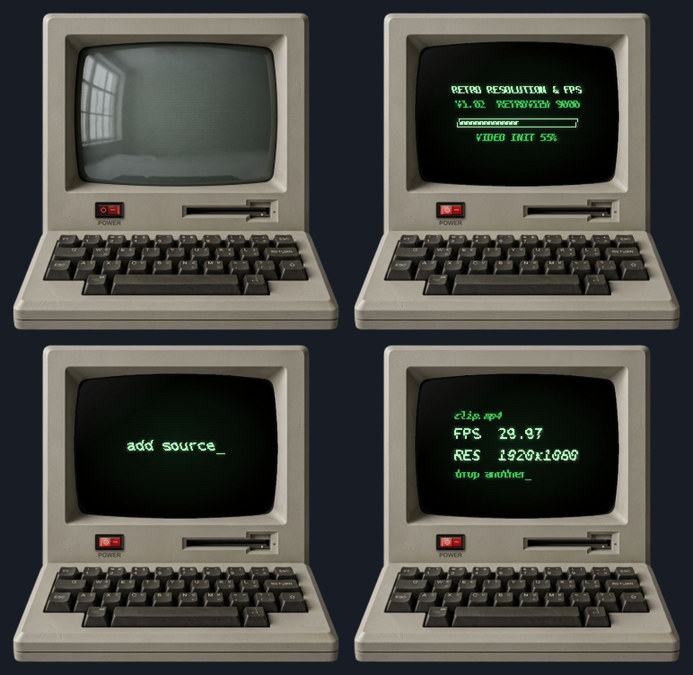
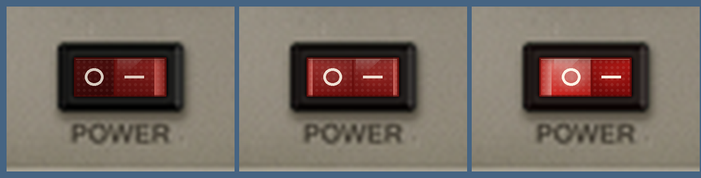

<p align="center"></p>

<h1 align="center">Retro Resolution & FPS</h1>

A small desktop widget for Windows that looks like a vintage CRT monitor. Drag a video file onto its screen and it tells you the video's **frame rate (FPS)** and **resolution**, in glowing green text.



The computer has no window frame or background. It sits on your desktop as a small, see-through widget, so your icons and wallpaper stay visible around it.

> The pictures in this README are mock-ups made while designing the program, so the real thing may differ slightly.

## Features

- Retro beige computer with a CRT screen and a transparent background
- Translucent red rocker power switch that tilts between ON and OFF
- CRT turn-on effect, boot screen with a progress bar, and a CRT shutdown effect
- CRT sound effects: switch click, degauss thunk, rising whine and static on power-on, and a collapsing whine and pop on power-off
- Drag and drop any video file to read its FPS and resolution
- Can be dragged anywhere on the desktop and kept on top of other windows

## Installing

### Option 1: Installer (easiest)

1. Go to the **[Releases](../../releases/latest)** page of this repository.
2. Under **Assets**, download `RetroResolutionFPS-Setup.exe`.
3. Double-click it, choose whether you want a desktop shortcut, and click **Install**.
4. Open **Retro Resolution & FPS** from the Start menu (or the desktop shortcut). If you left "Start the monitor when setup finishes" ticked, it opens by itself.

If the Releases page has no download yet, use Option 2 below to build the installer yourself.

The installer puts the program in your user folder, so it **doesn't need administrator rights**. It adds a Start menu shortcut called "Retro Resolution & FPS", and optionally a desktop shortcut.

Windows SmartScreen may say the publisher is unknown, because the installer isn't code-signed. Click **More info**, then **Run anyway**.

**Uninstalling:** open **Settings → Apps → Installed apps**, find **Retro Resolution & FPS**, and choose **Uninstall**. This removes the program and its shortcuts.

### Option 2: Build it yourself

You need Windows. Nothing else has to be installed, because the build uses the C# compiler that comes with Windows.

1. Download or clone this repository and extract it, so that all the files are in one folder.
2. Double-click one of these:
   - `build_installer.bat` builds `RetroResolutionFPS-Setup.exe`, the same installer as in Option 1.
   - `build.bat` builds just `RetroMonitor.exe`, which runs by itself with no install. It needs `RetroMonitor.cs`, `skin.png`, `icon.ico` and `build.bat` in the same folder.
3. When it finishes, the exe appears in the same folder.

The skin image is packed inside the exe, so `RetroMonitor.exe` needs no other files to run.

If Windows SmartScreen warns about a `.bat` file or an exe you built, click **More info**, then **Run anyway**.

## How to use it

### 1. Power it on

When you open the program, the monitor is switched **off** and the screen shows its dull grey glass.

Click the red rocker switch on the left of the computer's lower bezel, labelled **POWER**. The switch tilts across and the monitor starts up:



1. The screen flashes on and a burst of static fades out.
2. The title **RETRO RESOLUTION & FPS** types out.
3. A progress bar fills while it runs its start-up checks.
4. The screen shows **add source_** and is ready to use.

### 2. Scan a video

1. Drag a video file from a folder or the desktop onto the monitor's screen. The text changes to **drop to scan**.
2. Release the mouse button. The screen shows **scanning...** with a progress bar.
3. The result appears:

```
clip.mp4
FPS  29.97
RES  1920x1080
```

To scan another video, drop it onto the screen. The new result replaces the old one.

If you drop something that isn't a video, the screen shows **ERR: no video**.

### 3. Power it off

Click the red switch again. The picture shrinks to a line, then a dot, and fades out like an old monitor.

**Switching the monitor off does not close the program.** The monitor stays on your desktop, switched off, until you close it as described below. You can switch it on again at any time.

### 4. Move it around

Click and hold anywhere on the monitor's body (not on the switch) and drag it to where you want it. It starts near the top right of your screen.

### 5. Turn the sound effects off (or back on)

The monitor plays CRT sounds when you switch it on and off. To mute them:

1. Right-click the monitor.
2. Click **Sound effects** so the tick next to it disappears.

Click it again to bring the sounds back. The setting lasts until you close the program, and the sounds are on again the next time you open it.

## Right-click menu

Right-click anywhere on the monitor to open this menu:

| Menu item | What it does |
|---|---|
| **Always on top** | Keeps the monitor in front of other windows. Tick it again to turn it off. |
| **Sound effects** | Ticked by default. Click it to untick and mute the power-on and power-off sounds. |
| **Clear screen** | Clears the result and returns to **add source_**. |
| **Power off (exit)** | **Closes the program completely.** |

To close the program, right-click the monitor and choose **Power off (exit)**.

## Which video files work?

The program first asks Windows for the video's properties, which works for common formats such as MP4, MOV, AVI and WMV.

Some formats, such as MKV, Windows can't read. For those, the program uses **ffprobe** if it can find it:

1. Download FFmpeg, which includes `ffprobe.exe`, from ffmpeg.org.
2. Put `ffprobe.exe` in the same folder as `RetroMonitor.exe`, or add it to your Windows PATH.

If neither Windows nor ffprobe can read the file, the screen shows **ERR: no video**.

## Troubleshooting

**Dropping a file does nothing.**
- Check the monitor is switched on. Files are only accepted when the screen says **add source_**.
- Check the program isn't running as administrator. Windows blocks drag and drop from a normal window onto an administrator program. Close it and open it normally.

**It says ERR: no video for a real video.**
The format may not be supported by Windows. Add `ffprobe.exe` next to the program, as described above.

**The build fails.**
Make sure all the repository files are in the same folder (for the installer: `RetroMonitor.cs`, `Installer.cs`, `skin.png`, `icon.ico` and `build_installer.bat`), and that you extracted the zip first instead of running `build.bat` from inside it. If it still fails, open an issue and include the error message from the black window.

**I can't see the monitor.**
It starts near the top right of your main screen. If you have several screens, check the others.

## Files

| File | Purpose |
|---|---|
| `RetroMonitor.cs` | The program source code |
| `skin.png` | The monitor artwork |
| `icon.ico` | The program and installer icon |
| `build.bat` | Builds `RetroMonitor.exe` |
| `Installer.cs` | Source code of the installer |
| `build_installer.bat` | Builds `RetroResolutionFPS-Setup.exe` (the installer) |
| `LICENSE` | Licence terms |
| `images/` | Pictures used in this README |

## Licence

The source code is released under the MIT licence. See the `LICENSE` file for details. The monitor artwork in `skin.png` comes from a third-party image and may not be covered by that licence.
